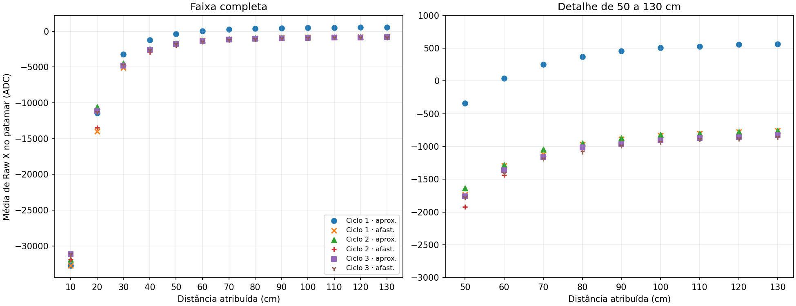
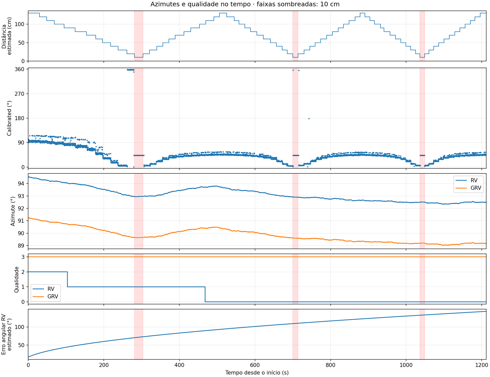
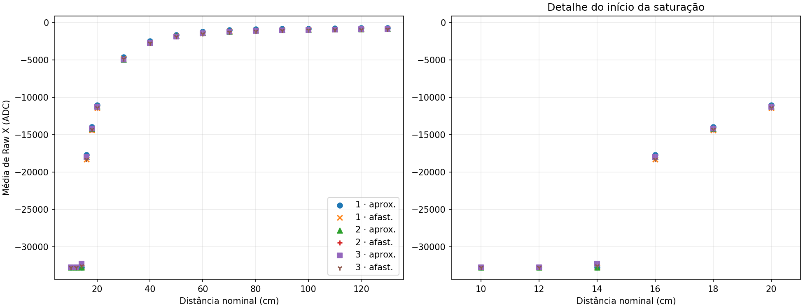
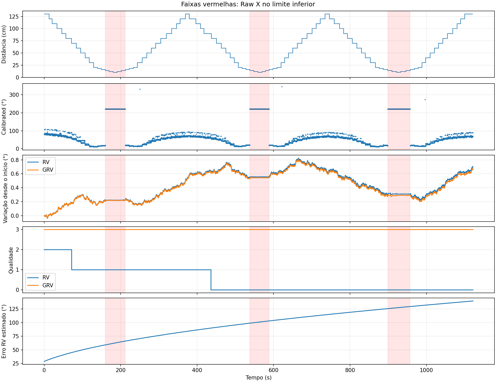

# Aproximação e afastamento de um ímã frente à trena

## Primeiro ensaio · passos de 10 cm

Coleta de **14/11/2026, 15:46:20, horário de Brasília**, iniciada em
2026-11-14T18:46:20 UTC. Foram registradas **5.908 amostras**, de 0,004679 s
até 1.211,874599 s, aproximadamente 20 min 12 s. A fonte é
[samples.csv](20261114T184620.052565Z_989139b4503646d4bc42b772811b4063/samples.csv), com configuração inicial em [metadata.json](20261114T184620.052565Z_989139b4503646d4bc42b772811b4063/metadata.json).
O protocolo abaixo foi informado pelo operador após a coleta, cujo campo de
notas na metadata estava vazio.

## Protocolo executado

1. A trena foi apoiada sobre uma mesa de madeira e alinhada com uma das bordas.
2. A partir do plano da face frontal da trena, onde sai o feixe laser, foi
   marcada uma linha reta de 1,3 m. Uma régua de 1 m foi usada para a primeira
   marcação e essa marca serviu como referência para estender a linha até 1,3 m.
3. Um ímã foi posicionado inicialmente a 1,3 m, com a face sul voltada para a
   face frontal da trena.
4. O ímã foi aproximado em passos de 10 cm, até 10 cm da face frontal. O operador
   manteve cada posição por aproximadamente 10 s. Na distância de 10 cm,
   observou saturação do eixo X do magnetômetro Raw.
5. O movimento relativo foi invertido, aumentando a separação em passos de
   10 cm até retornar a 1,3 m, novamente com paradas em cada posição.
6. A aproximação e o afastamento foram repetidos mais duas vezes, totalizando
   três ciclos completos.

O relato descreve mover o ímã na aproximação e “afastar a trena” no retorno.
A análise usa a distância relativa entre ímã e face frontal e mantém essa
ambiguidade sobre qual objeto foi deslocado no afastamento. Uma translação da
trena mudaria também sua posição no campo do ambiente, mesmo mantendo a orientação.
As distâncias são nominais, baseadas nas marcações descritas pelo operador.

## Seleção dos pontos por distância

O CSV registra tempo e sensores, sem marcadores de distância ou comandos de
mudança de posição. Os limites dos patamares foram estimados visualmente a partir
dos degraus de Raw X, com apoio de medianas temporais de 2 s e da ordem do protocolo.
Não foram impostos intervalos exatos de 10 s. As durações observadas incluem
paradas mais longas e os períodos de movimentação não estão anotados separadamente.

Cada ponto do gráfico representa a média aritmética de todas as leituras de Raw X
no intervalo da parada (início inclusivo, fim exclusivo), incluindo as saturadas.
O cálculo usa os limites já registrados. As contagens de amostras e as médias
por parada estão em [medias_patamares.csv](20261114T184620.052565Z_989139b4503646d4bc42b772811b4063/analise_ima/medias_patamares.csv).
As paradas de inversão foram compartilhadas entre os dois sentidos, resultando
em 73 paradas e seis trajetórias com 13 pontos cada. Os pontos compartilhados
aparecem nas duas trajetórias pertinentes.

A atribuição das distâncias depende dessa reconstrução. A incerteza aumenta nas
maiores separações, onde a mudança de campo entre passos se aproxima da dispersão.
Os limites e os instantes selecionados estão em
[pontos_centrais.csv](20261114T184620.052565Z_989139b4503646d4bc42b772811b4063/analise_ima/pontos_centrais.csv), permitindo revisar as
atribuições. Não existe sincronização externa que certifique esses limites.

## Raw X em função da distância



O painel esquerdo mostra a faixa completa. O direito amplia as distâncias de
50 a 130 cm. Todos os valores estão em contagens ADC nativas, sem conversão para
µT. Na coleta inteira, Raw X variou de **−32.768 a +823 ADC**.

| Posição | Amostras | Média de Raw X (ADC) |
| --- | ---: | ---: |
| Início a 130 cm | 146 | 562,17 |
| 10 cm, ciclo 1 | 112 | -32768,00 |
| Retorno a 130 cm, ciclo 1 | 93 | -758,31 |
| 10 cm, ciclo 2 | 68 | -31914,49 |
| Retorno a 130 cm, ciclo 2 | 63 | -828,14 |
| 10 cm, ciclo 3 | 63 | -31135,40 |
| Retorno final a 130 cm | 78 | -854,95 |

A leitura atinge o limite inferior de representação de 16 bits nas três
aproximações. A partir desse limite, a magnitude adicional do campo não pode ser
quantificada por Raw X. O retorno à distância nominal inicial apresenta uma
mudança na média de 562,17 para -758,31 ADC já no primeiro ciclo. Há diferença entre as
trajetórias de ida e volta, e o valor inicial não foi recuperado nos retornos.

## Azimutes e qualidade da fusão



Os painéis compartilham o tempo. As faixas vermelhas indicam os patamares de
10 cm reconstruídos. Os azimutes RV/GRV têm um painel próprio para tornar visível
sua variação pequena, enquanto Calibrated ocupa outro painel. A qualidade RV e
GRV aparece no painel seguinte, de 0 a 3. O último painel converte a estimativa
de precisão RV de radianos para graus.

O azimute Calibrated foi calculado no firmware a partir do campo calibrado,
com compensação de inclinação pela vertical do GRV e frente +X. RV e GRV usam
as mesmas equações geométricas de orientação. O GRV tem referência arbitrária.
Não foi aplicado alinhamento angular aos dados deste gráfico.

A tabela de azimutes usa as leituras centrais listadas em pontos_centrais.csv.

| Posição | Calibrated (°) | RV (°) | Qualidade RV | GRV (°) | Qualidade GRV |
| --- | ---: | ---: | ---: | ---: | ---: |
| Início, 130 cm | 93,35 | 94,44 | 2 | 91,14 | 3 |
| 10 cm, ciclo 1 | 43,02 | 92,96 | 1 | 89,64 | 3 |
| 10 cm, ciclo 2 | 43,03 | 92,90 | 0 | 89,60 | 3 |
| 10 cm, ciclo 3 | 43,04 | 92,50 | 0 | 89,19 | 3 |
| Retorno final, 130 cm | 43,79 | 92,50 | 0 | 89,18 | 3 |

O azimute RV permaneceu entre **92,3271° e 94,5436°**, amplitude de **2,2165°**.
O GRV ficou entre **89,0079° e 91,2311°**, amplitude de **2,2232°**.
A qualidade GRV ficou em **3** nas 5.908 amostras.

A qualidade RV iniciou em **2**, caiu para **1 aos 103,8 s** e para **0 aos
468,1 s**, mantendo esse valor até o fim. A primeira queda aconteceu antes da
primeira saturação. A segunda ocorreu durante o primeiro afastamento.
A estimativa angular RV aumentou de 0,301513672 rad para até 2,49902344 rad,
aproximadamente **17,28° a 143,18°**.
O azimute RV continuou estável enquanto sua qualidade e precisão estimada
pioravam. A recuperação da distância de 130 cm não recuperou a qualidade inicial
na duração deste ensaio. A qualidade 3 do GRV diz respeito à sua própria fusão,
com referência de heading arbitrária, e não valida o norte magnético.

## Observação de saturação e comportamento de Uncalibrated/Calibrated

O operador observou que, com o ímã muito próximo e Raw X saturado, os três eixos
Uncalibrated ficam em zero e Calibrated passa a apresentar apenas os valores
associados ao viés. A conferência do CSV encontrou correspondência nas **261
amostras** com Raw X igual a −32.768. Todas têm

```text
Uncalibrated XYZ = (0, 0, 0) µT
Calibrated XYZ   = (+27,750; +24,875; +8,875) µT
```

Também são exatamente essas 261 amostras que apresentam os três componentes
Uncalibrated simultaneamente nulos. O CSV não fornece um sinalizador próprio de
saturação, e essa classificação foi feita pela leitura limite do ADC.

| Ciclo | Intervalo observado de Raw X = −32.768 (s) | Amostras | Azimute Calibrated, mín.–máx. (°) |
| --- | --- | ---: | --- |
| 1 | 279,538–305,955 | 130 | 43,0066–43,0220 |
| 2 | 700,801–715,548 | 73 | 43,0334–43,0472 |
| 3 | 1.036,977–1.048,550 | 58 | 43,0410–43,0579 |

Pela relação observada entre relatórios `Cal = Uncal − viés`, esses valores de
Cal correspondem ao **negativo** de um viés estimado
`(−27,750; −24,875; −8,875) µT`. Essa é uma inferência por diferença entre
relatórios. O viés nativo que acompanha o report Uncal não é registrado no CSV.

O vetor Cal permanece exatamente igual nesses trechos e, com inclinação quase
constante, produz um azimute praticamente constante de 43°. As pequenas diferenças
entre ciclos vêm acompanhadas de diferenças na orientação usada na compensação.
Essa constância durante a saturação deve ser interpretada no contexto do vetor
residual do processamento, sem tratá-la como evidência de uma direção magnética
confiável a 10 cm.

## Hipótese de magnetização permanente

O operador levantou a hipótese de que a primeira aproximação produziu uma
**magnetização permanente no sensor**. O deslocamento de Raw X entre o início e
os retornos à distância nominal de 130 cm é compatível com uma alteração
persistente durante os aproximadamente 20 minutos registrados. A hipótese fica
registrada como hipótese, pois a coleta não identifica a origem física nem
estabelece permanência após retirar o ímã, desligar o equipamento ou esperar
por mais tempo. Alteração da montagem/posição, campo ambiente, estado do sensor
e evolução da calibração também podem contribuir para os resultados.

## Limitações da interpretação

- Distâncias e limites dos patamares foram reconstruídos do relato e do sinal.
- A linha de 1,3 m foi estendida a partir de uma régua de 1 m. Não há registro de
  incerteza de posicionamento, alinhamento ou geometria do ímã.
- O objeto deslocado no afastamento permanece ambíguo no relato.
- Os reports magnéticos e de orientação são assíncronos. O CSV contém snapshots,
  sem timestamps e qualidade de cada relatório magnético individual.
- O ensaio não inclui referência externa de norte ou medição independente do campo.
- A metadata é inicial e não certifica o estado de restauração no encerramento.

Esses limites devem acompanhar o uso das curvas, especialmente ao estimar
histerese, distância de influência do ímã ou persistência da mudança de Raw X.


## Segundo ensaio · passos de 2 cm entre 20 e 10 cm

A coleta de 14/11/2026 às 17h54 (Brasília) registrou 5.450 amostras em 18 min 42 s.
O operador repetiu os três ciclos na mesa de madeira, com o polo sul do ímã voltado
para a face frontal da trena e paradas de aproximadamente 10 s. Entre 130 e 20 cm
a separação variou de 10 em 10 cm. Entre 20 e 10 cm foram acrescentadas paradas
a 18, 16, 14 e 12 cm, percorridas também na volta.
[Dados originais](20261114T205421.149786Z_ad548873a052428ab1af27b3cc52eaff/samples.csv) e [metadata](20261114T205421.149786Z_ad548873a052428ab1af27b3cc52eaff/metadata.json).

### Reconstrução das paradas

A sequência corresponde a 97 paradas, contando cada inversão uma vez.
Os horários foram estimados a partir dos degraus do sinal, pois o CSV não registra
distâncias. Para refinar cada fronteira visual, buscou-se num intervalo de ±3 s,
em passos de 0,25 s, a maior distância euclidiana entre as medianas de Raw XYZ
nos 2 s anteriores e seguintes. A média de cada parada usa todas as amostras no
intervalo de início inclusivo e fim exclusivo. As 5.450 leituras foram atribuídas
uma única vez. Nas maiores distâncias os pequenos degraus se confundem com o ruído.

Com X travado no limite, Raw Z distinguiu claramente as posições. Os níveis típicos
foram cerca de 6.200 ADC a 14 cm, 9.200 a 12 cm e 14.500 a 10 cm, em ordem inversa
no afastamento. Raw Y também variou entre esses patamares.
[Limites estimados, médias XYZ, contagens de saturação e ângulos centrais](20261114T205421.149786Z_ad548873a052428ab1af27b3cc52eaff/analise_ima/medias_patamares.csv).

### Raw X e distância de saturação



| Distância nominal | Amostras com X = −32.768 / total | Faixa das médias de X por patamar, ADC arredondado |
| ---: | ---: | ---: |
| 20 cm | 0 / 305 | −11.453 a −11.065 |
| 18 cm | 0 / 295 | −14.413 a −13.946 |
| 16 cm | 0 / 302 | −18.316 a −17.718 |
| 14 cm | 307 / 312 | −32.768 a −32.208 |
| 12 cm | 322 / 322 | −32.768 |
| 10 cm | 156 / 156 | −32.768 |

**A primeira parada com saturação foi a de 14 cm nas três aproximações.**
A amostragem espacial situa a transição entre as marcas de 16 e 14 cm.
Os cinco pontos fora do limite nas janelas atribuídas a 14 cm devem ser
interpretados considerando a incerteza temporal das fronteiras.

A média de Raw X a 130 cm começou em −729 ADC. Os três retornos produziram
−863, −910 e −906 ADC. A diferença entre o último retorno e o início foi de
−176 ADC, menor em módulo que os −1.417 ADC do primeiro ensaio.
O segundo ensaio já começou com Raw X negativo. As duas séries documentam a
persistência de uma mudança de leitura, mas faltam controles independentes
de campo e posição para testar a hipótese de magnetização permanente.

### Azimutes e qualidade



As faixas vermelhas marcam as leituras saturadas de Raw X. O painel Calibrated
mostra azimute absoluto. Para comparar pequenas mudanças de RV e GRV, o painel
seguinte mostra o deslocamento angular de cada um desde sua própria leitura inicial.
A tabela apresenta os azimutes absolutos na amostra central de cada parada indicada.

| Parada | Calibrated | RV | GRV | Qualidade RV / GRV |
| --- | ---: | ---: | ---: | ---: |
| 130 cm inicial | 85,90° | 62,98° | 316,23° | 2 / 3 |
| 10 cm, ciclo 1 | 221,55° | 63,21° | 316,46° | 1 / 3 |
| 10 cm, ciclo 2 | 221,56° | 63,54° | 316,78° | 0 / 3 |
| 10 cm, ciclo 3 | 221,56° | 63,29° | 316,53° | 0 / 3 |
| 130 cm final | 89,41° | 63,63° | 316,85° | 0 / 3 |

O azimute RV variou 0,86° (62,94° a 63,81°) e o GRV 0,84° (316,20° a
317,05°). A qualidade RV caiu de 2 para 1 aos 71,8 s, antes da primeira
saturação, e para 0 aos 436,3 s, durante a segunda aproximação. Ficou em 0
até o final. A estimativa de erro do RV abrangeu aproximadamente 28,83° a
139,73°. A qualidade GRV permaneceu em 3. Como no primeiro ensaio, a perda de
qualidade RV foi muito maior do que sugeriria a pequena variação do azimute.

Nas **785 amostras saturadas**, Uncalibrated XYZ foi exatamente (0, 0, 0) µT
e Calibrated XYZ ficou em (−35,8125; −31,4375; −2,875) µT. O azimute Calibrated
variou apenas de **221,548° a 221,559°**. O comportamento reproduz o vetor
residual observado no primeiro ensaio, desta vez com componentes e ângulo
diferentes. Pela relação Cal = Uncal − viés, o vetor residual é compatível
com o negativo do viés da sessão. O CSV não contém a estimativa nativa do viés.
